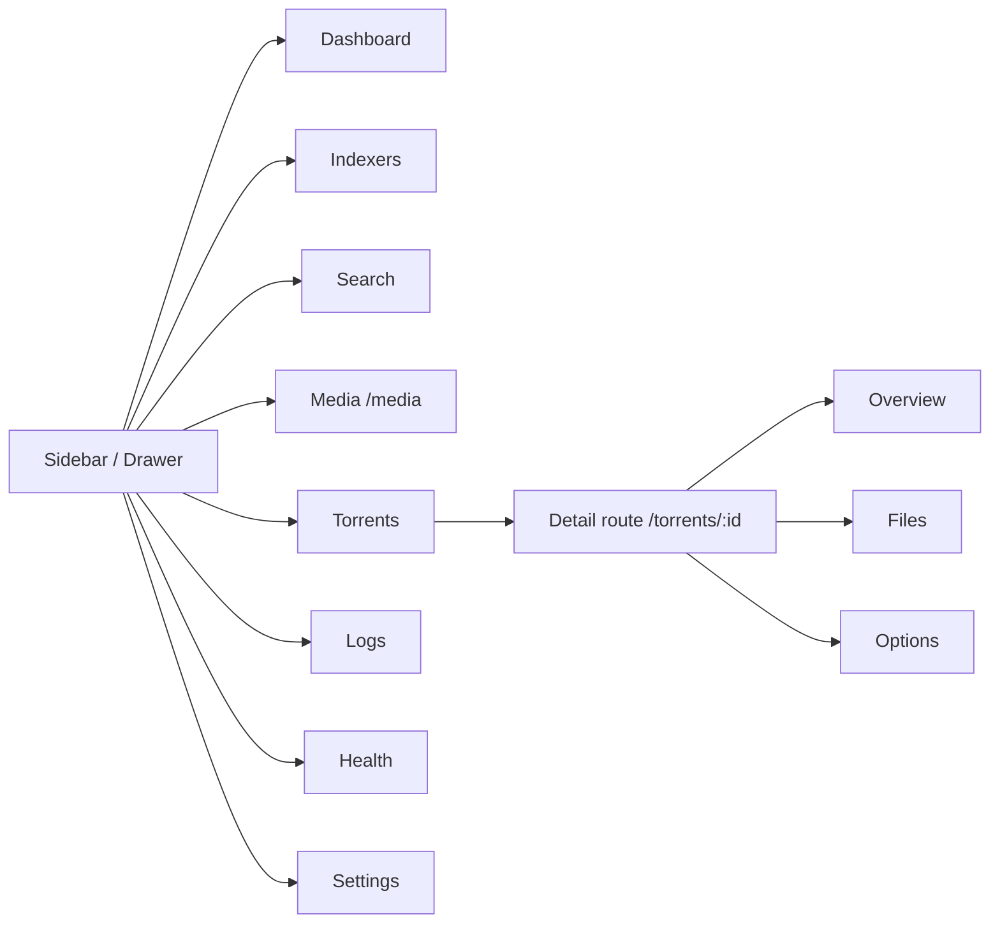
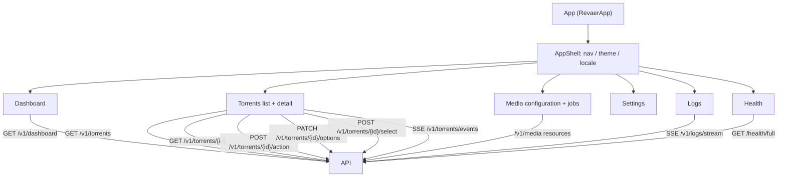
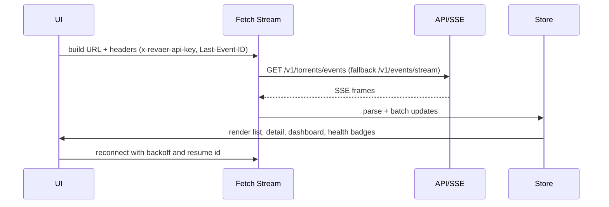
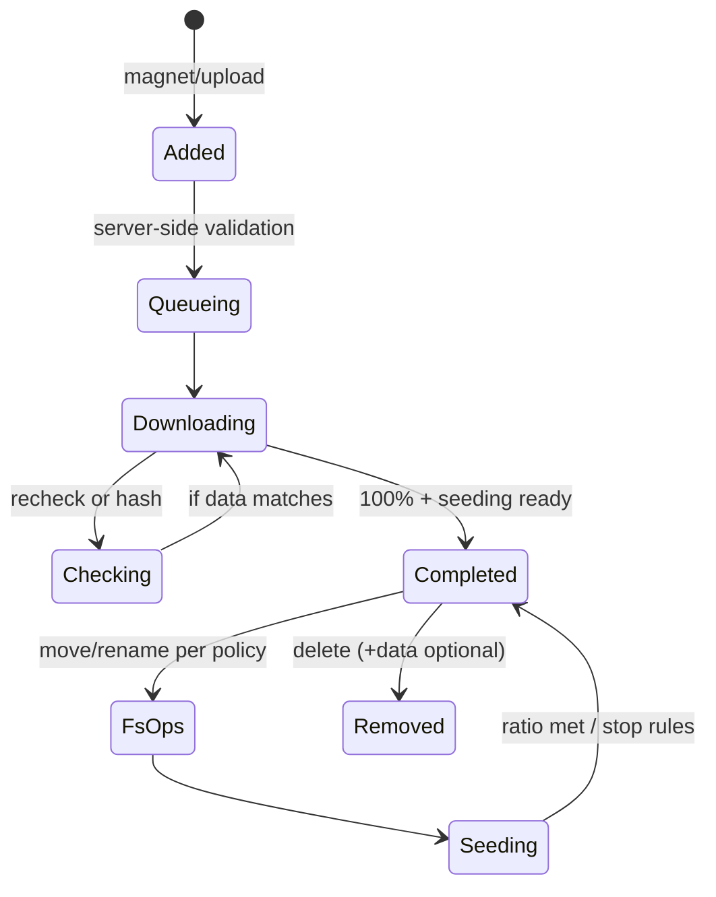

# Web UI Flows and Diagrams

Visual references for navigation, component wiring, SSE handling, torrent lifecycle and media transcoding. Use these diagrams when extending the UI or adding tests.

## Navigation flow

## Component graph

## SSE event flow

## Torrent lifecycle (UI perspective)

## Interaction notes

- SSE disconnect overlay shows last event timestamp, retry countdown (1s to 30s exponential with jitter), and diagnostics (auth mode, reason).
- Table virtualization is required beyond 500 rows; virtual scroll must preserve keyboard focus order and pinned columns.
- Mobile detail view uses tabs (Overview, Files, Options); desktop uses a split layout so overview and options stay visible together at lg+.

## Media processing flow

Profiles and root associations select an immutable configuration snapshot for
discovery. Manual, watcher and scheduled discovery converge on the same bounded
admission path. Dry-run inspects and plans without replacing originals; enabled
processing executes locally and verifies output before replacement. Restart
replays unfinished steps and reconciles interrupted replacement through its
backup/manifest. See the [transcoding design](https://github.com/VannaDii/revaer/blob/main/MEDIA_TRANSCODING.md#recovery-concurrency-and-scratch)
for cancellation, scratch and cleanup semantics.
